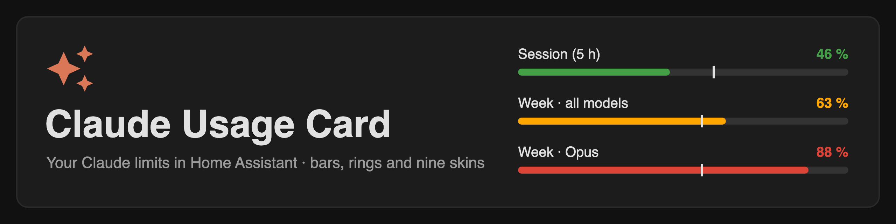

A Lovelace card that shows your Claude subscription limits (5-hour session, weekly limits, per-model limits, extra usage) as bars, rings or one of nine skins, with a countdown to each reset.

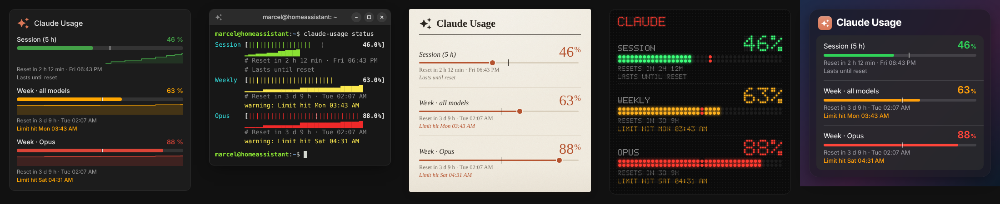

The card only reads sensors. The data comes from the **[Claude Usage integration](https://github.com/trickv/hass-claude-usage)**, which you need to install first.

> This is a community project. It is not affiliated with or endorsed by Anthropic.

## Features

- Detects all limit sensors of the integration automatically, including new model limits
- Three layouts: `bars` (stacked), `columns` (side by side) and `rings`
- Minimal style: one compact line per limit
- Nine skins: `terminal` (amber CRT), `retro` (90s desktop window), `synthwave` (neon sunset), `paper`, `cupertino` (Apple-style), `shell` (Linux terminal), `material` (Material You), `matrix` (dot matrix) and `eink` (black and white for e-paper displays)
- Countdown and/or local time of the next reset
- Colors by your own thresholds or by the `severity` the API reports
- Configurable logo: any MDI icon or your own image
- Extra usage (only when enabled) and API error hint
- Visual editor, English and German
- Pace marker: shows where you would be with even usage across the period
- Forecast: when the limit will be reached at the current rate (from HA history)
- Mini history: sparkline of the last hours
- Configurable tap, hold and double tap actions (default: more-info)
- Hint when the data is stale, for example during an API rate limit
- Several accounts in one card: labels, extra usage and API errors show the account name (or use `filter` for one card per account)

## Requirements

- Home Assistant with the **[Claude Usage integration](https://github.com/trickv/hass-claude-usage)** installed and set up. Search for **Claude Usage** in the Marketplace (or HACS before Home Assistant 2026.11) to install it. This card shows nothing without it.
- The recorder (enabled by default) for the forecast and the mini history.

## Installation

### Marketplace (Home Assistant 2026.11 and later)

1. Settings → **Marketplace**, search for **Claude Usage Card** and install it
2. Reload the browser

If the card does not show up in the search yet, add it with **Add from link** and this repository's URL.

### HACS (Home Assistant 2026.10 and older)

1. Open HACS, search for **Claude Usage Card** and download it
2. Reload the browser

If the card does not show up in the search, add it as a custom repository first: HACS → three-dot menu → **Custom repositories** → add this repository's URL, type **Dashboard**.

### Manual

1. Copy `dist/claude-usage-card.js` to `/config/www/`
2. Settings → Dashboards → three-dot menu → **Resources** → add `/local/claude-usage-card.js` as **JavaScript module**

## Usage

Add the card in the dashboard editor (search for **Claude Usage Card**) or in YAML. Without any options it detects all limit sensors of the integration:

```yaml
type: custom:claude-usage-card
```

All screenshots use the same data: session 46 %, weekly 63 %, Opus 88 %.

## Styles

<table>
<tr><td align="center" valign="top" width="33%">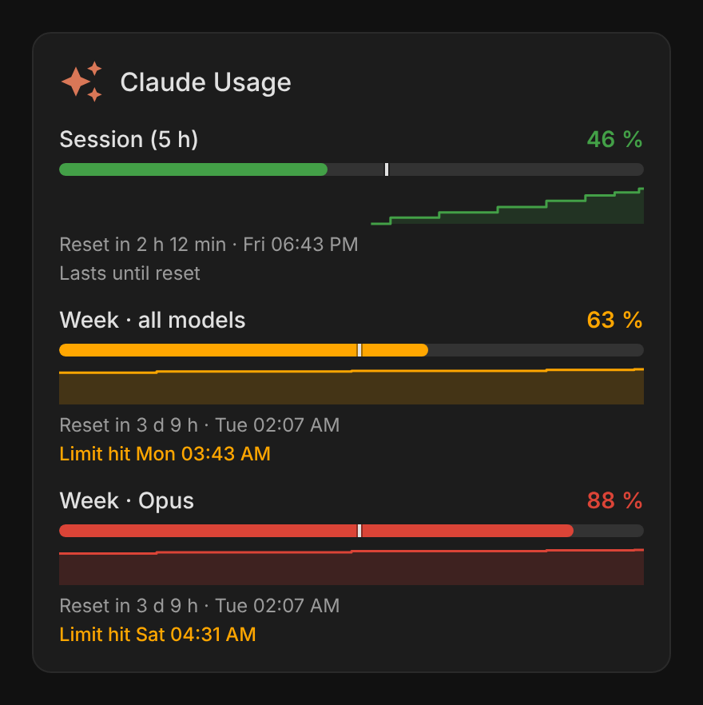<br><b>Bars (default)</b></td><td align="center" valign="top" width="33%">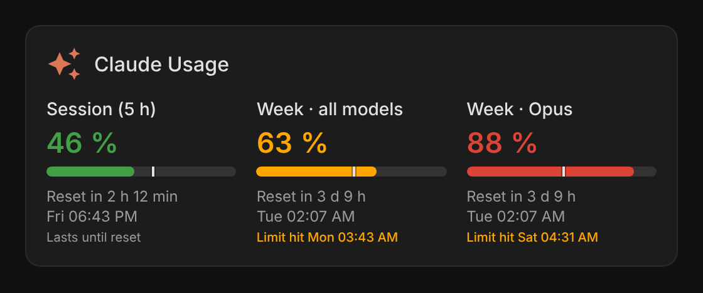<br><b>Columns</b></td><td align="center" valign="top" width="33%">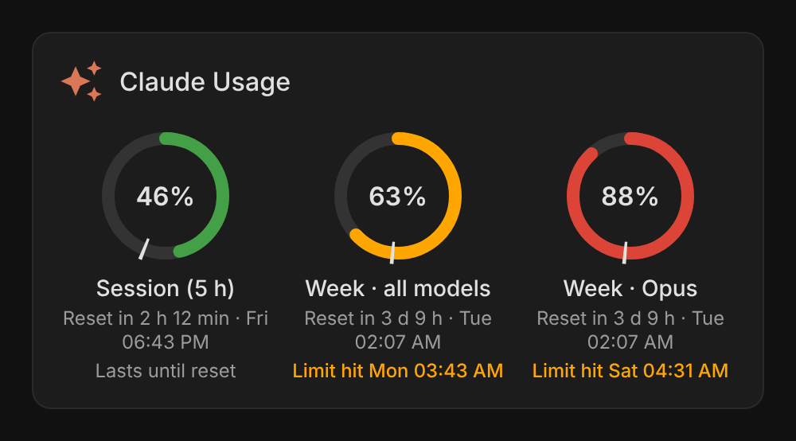<br><b>Rings</b></td></tr>
<tr><td align="center" valign="top" width="33%">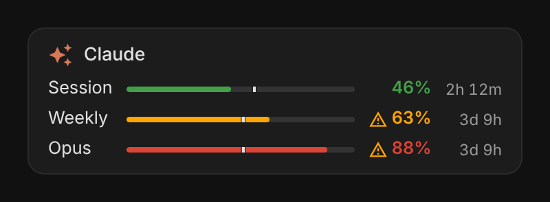<br><b>Minimal</b></td><td align="center" valign="top" width="33%">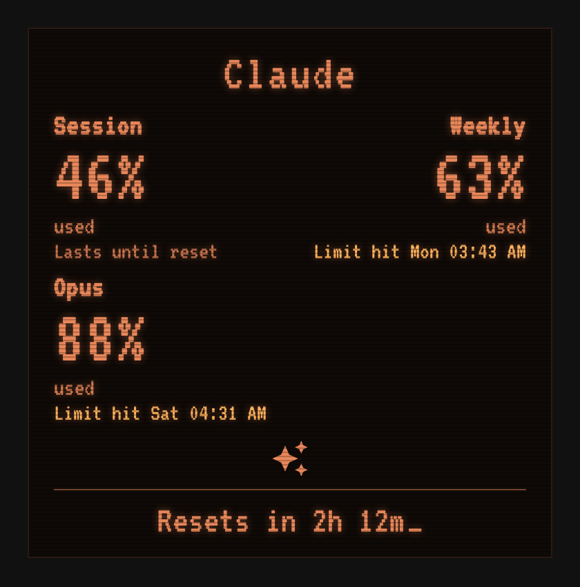<br><b>Terminal</b></td><td align="center" valign="top" width="33%">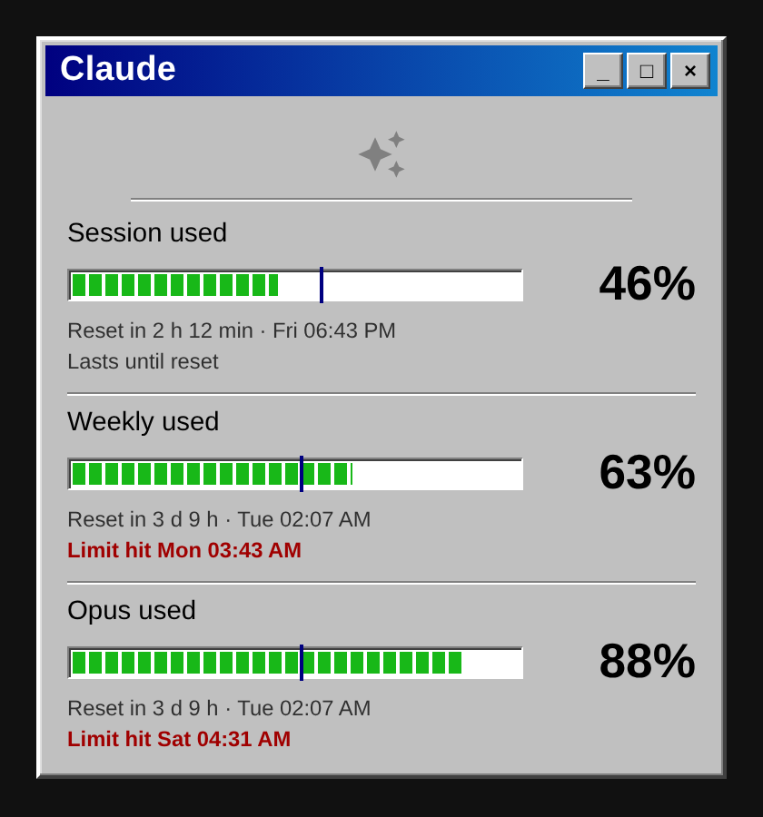<br><b>Retro window</b></td></tr>
<tr><td align="center" valign="top" width="33%">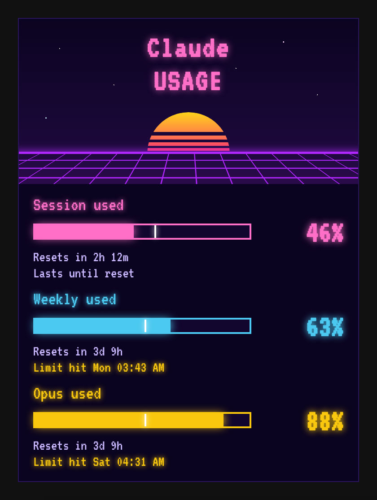<br><b>Synthwave</b></td><td align="center" valign="top" width="33%">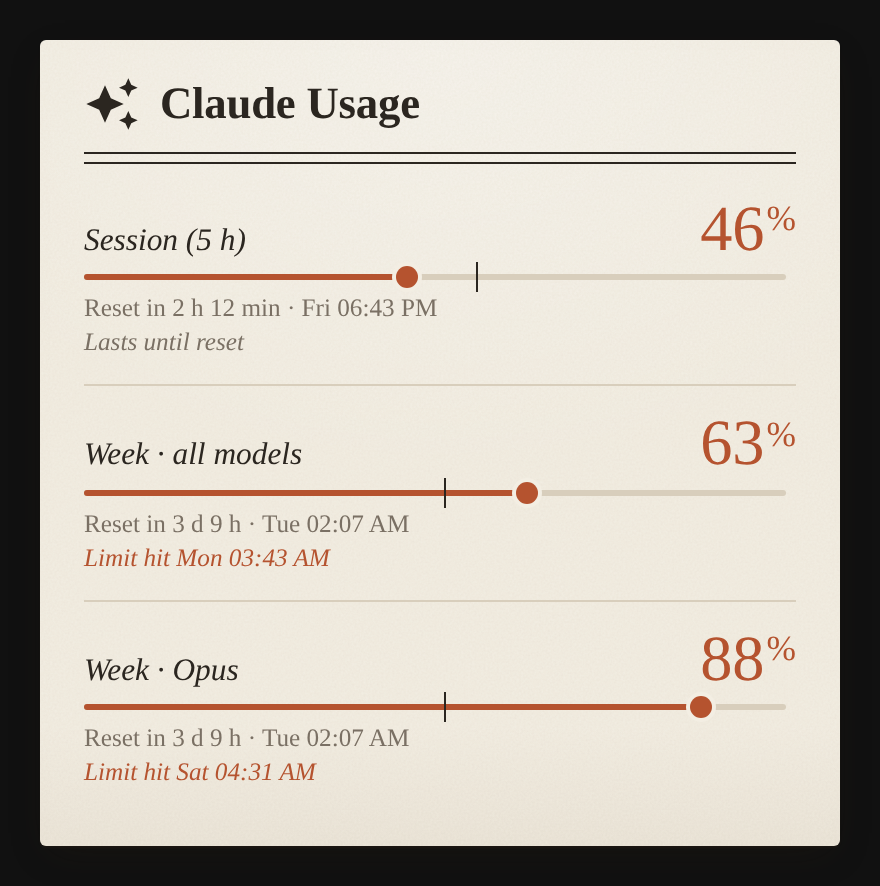<br><b>Paper</b></td><td align="center" valign="top" width="33%">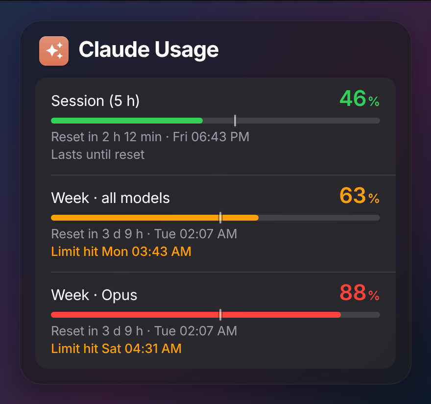<br><b>Cupertino</b></td></tr>
<tr><td align="center" valign="top" width="33%">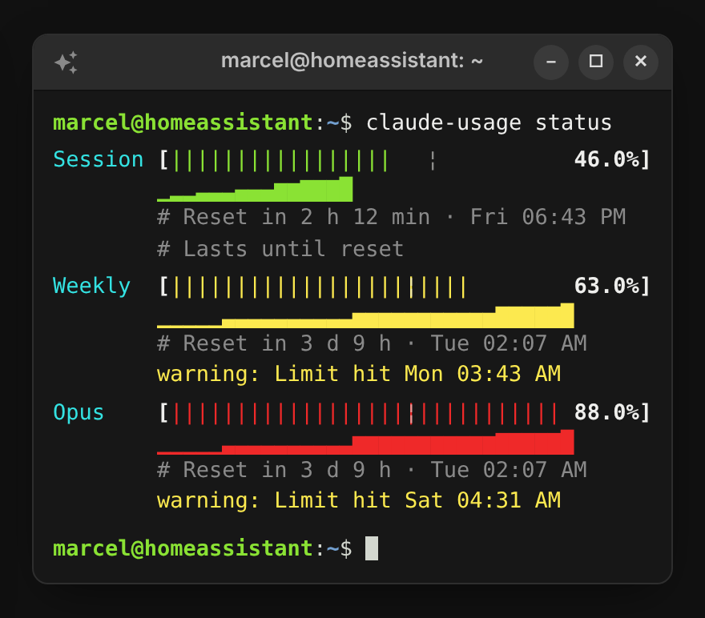<br><b>Shell</b></td><td align="center" valign="top" width="33%">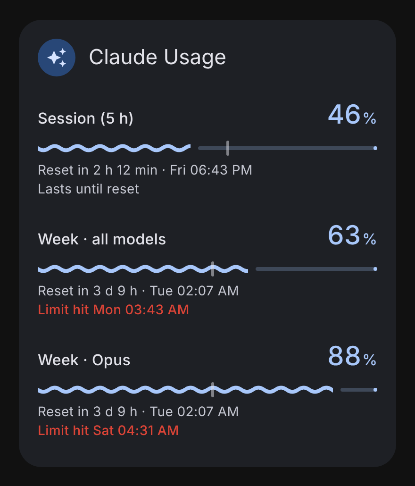<br><b>Material You</b></td><td align="center" valign="top" width="33%">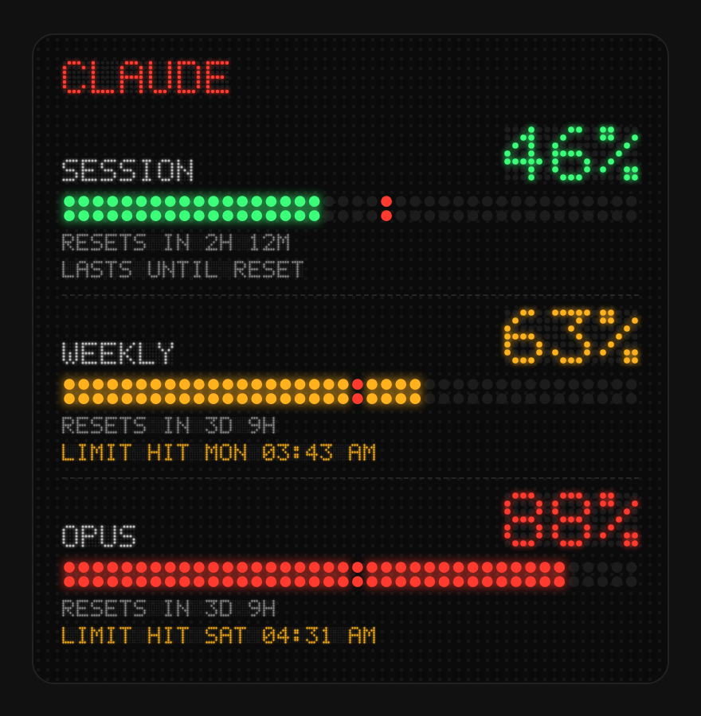<br><b>Dot matrix</b></td></tr>
<tr><td align="center" valign="top" width="33%">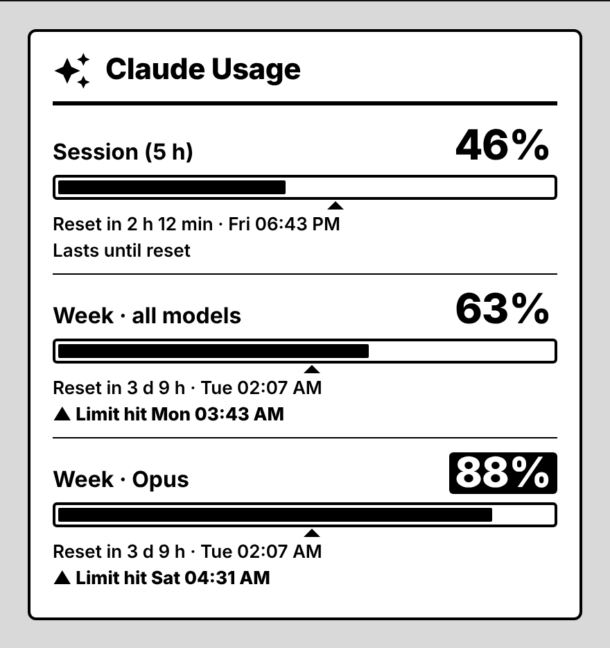<br><b>E-ink</b></td></tr>
</table>

| Style | Look | Config |
|---|---|---|
| Bars | Stacked bars that follow your Home Assistant theme (shown with the mini history) | `show_history: true` |
| Columns | Bars side by side, one column per limit, good for wide cards | `layout: columns` |
| Rings | One ring per limit | `layout: rings` |
| Minimal | One compact line per limit; a warning icon when the forecast says the limit is reached before the reset | `style: minimal` |
| Terminal | Amber CRT with scanlines and the embedded pixel font | `style: terminal` |
| Retro window | 90s desktop window with segmented progress bars | `style: retro` |
| Synthwave | Neon sunset with a perspective grid | `style: synthwave` |
| Paper | Ink on paper: serif type, a double rule under the title, ink-blot markers | `style: paper` |
| Cupertino | Apple-style material, inset grouped list, system colors; follows light or dark mode (shown with `status_colors: true`) | `style: cupertino` |
| Shell | Linux terminal with prompt, htop-style meters and the history as block characters; the prompt uses your user name and the name of your home | `style: shell` |
| Material You | Material 3 with the wavy progress indicator, colors from your theme | `style: material` |
| Dot matrix | Text and numbers in a 5×7 dot font, bars as rows of LED dots | `style: matrix` |
| E-ink | Pure black and white without motion, for e-paper wall displays; critical values are inverted | `style: eink` |

The skins use their own colors. With `status_colors: true` they use the threshold colors (green, orange, red) instead. `font` switches the font, for example `font: monospace` or `font: custom` with `font_custom: "'Press Start 2P'"`.

## More examples

Custom names, thresholds and a countdown only:

```yaml
type: custom:claude-usage-card
title: Claude
warning_threshold: 50
critical_threshold: 80
reset_display: relative
names:
  sensor.claude_usage_my_account_session_limit_usage: Session
  sensor.claude_usage_my_account_weekly_all_models_limit_usage: Week
```

One card per account when you have several:

```yaml
type: custom:claude-usage-card
filter: my_account
```

Open the history on hold instead of the more-info dialog on tap:

```yaml
type: custom:claude-usage-card
tap_action:
  action: none
hold_action:
  action: navigate
  navigation_path: /history
```

Hide the pace marker and forecast, show only the bars:

```yaml
type: custom:claude-usage-card
show_pace: false
show_forecast: false
show_reset: false
```

## Options

| Option | Default | Description |
|---|---|---|
| `title` | localized "Claude Usage" | Card title |
| `show_title` | `true` | Show the title |
| `style` | `default` | `default` (follows your theme), `minimal` (one compact line per limit), or a skin: `terminal`, `retro`, `synthwave`, `paper`, `cupertino`, `shell`, `material`, `matrix`, `eink` |
| `layout` | `bars` | `bars` (stacked), `columns` (side by side) or `rings` (style `default` only) |
| `show_logo` | `true` | Show the logo |
| `icon` | `mdi:creation` | MDI icon used as logo |
| `logo_url` | – | Image used as logo instead of the icon, e.g. `/local/my-logo.svg` |
| `logo_color` | `#d97757` | Icon color (any CSS color or `[r, g, b]`) |
| `logo_size` | `28` | Logo size in px |
| `entities` | auto | List of limit sensors; empty means auto-detect. Items can be strings or `{entity, name}` |
| `exclude` | `[]` | Sensors to hide in auto mode |
| `filter` | – | Only auto-detect sensors whose entity ID contains this text (useful with several accounts) |
| `names` | `{}` | Custom labels per entity ID (also editable in the visual editor) |
| `color_mode` | `threshold` | `threshold` or `severity` |
| `warning_threshold` | `60` | Percent from which the warning color is used |
| `critical_threshold` | `85` | Percent from which the critical color is used |
| `color_ok` / `color_warning` / `color_critical` | theme colors | Any CSS color or `[r, g, b]`. The visual editor shows the current theme colors and only writes `[r, g, b]` when you change a color |
| `status_colors` | `false` | Skins: use threshold/severity colors instead of the skin palette (`paper`, `cupertino`, `shell` and `matrix` use their own matching shades) |
| `font` | `auto` | Skins: `auto` (pixel for terminal and synthwave, the skin's classic font for the others), `pixel` (embedded VT323 subset), `classic`, `theme`, `monospace` or `custom` |
| `font_custom` | – | CSS `font-family` used when `font: custom` |
| `color_values` | `true` | Color the percentages like the bars |
| `show_reset` | `true` | Show the reset line |
| `reset_display` | `both` | `relative`, `absolute` or `both` |
| `show_extra_usage` | `true` | Show extra usage when it is enabled on the account |
| `show_api_error` | `true` | Show a hint when the integration reports API errors |
| `show_pace` | `true` | Marker for even usage (session = 5 h, weekly = 7 days) |
| `show_forecast` | `true` | Projected time the limit is reached; rate from the last hour (session) or last 24 h (weekly) |
| `show_history` | `false` | Sparkline of the last hours from HA history |
| `stale_minutes` | `30` | Show "Last update … ago" when no fresh data arrived for this many minutes (`0` = off) |
| `tap_action` / `hold_action` / `double_tap_action` | `more-info` / `none` / `none` | Standard Home Assistant actions; `entity` is the tapped sensor |
| `history_hours` | `6` | Time span of the sparkline in hours |

## Logo

The card ships without any third-party logo. To use your own image, put it into `/config/www/` and set `logo_url: /local/<file>`. Make sure you have the right to use the image.

## Font

The terminal and synthwave styles embed a subset of [VT323](https://github.com/phoikoi/VT323) (SIL Open Font License 1.1, see `fonts-OFL-VT323.txt`). The dot matrix skin uses its own 5×7 dot font. Both are bundled in the JS file, so no external request is made. The other skins use fonts that are already on the device (for example SF Pro on Apple devices, Roboto on Android).

## Development

- `node test/forecast.test.js` and `node test/render.test.js` run the tests; the render test draws every style once.
- `node tools/screenshots/shoot.mjs` renders `tools/screenshots/gallery.html` with sample data and writes all images in `docs/images/` (needs Playwright with Chromium).

## License

MIT (card code). The embedded font is licensed under the SIL Open Font License 1.1.
